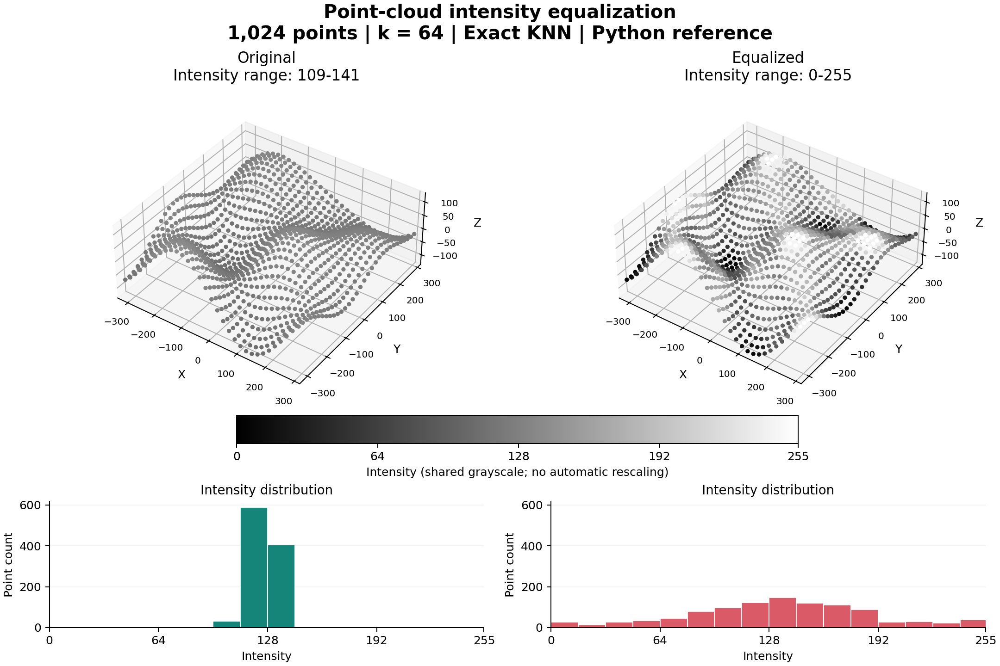

# CUDA-Accelerated 3D Point Cloud Histogram Equalization

A C++/CUDA project for adjusting intensity contrast in unstructured 3D point clouds. It compares three spatial neighborhoods: exact K-nearest neighbors, a Morton-order approximation, and K-means clusters. Coordinates and point order are preserved; only 8-bit intensities change.

The implementation combines custom CUDA kernels with OpenMP host preprocessing, a sequential C++ baseline, a readable Python reference, and reproducible validation and benchmarking tools. Developed from a COL380 parallel-programming assignment; the [original specification](docs/assignment.pdf) is preserved for attribution and context.

## Visual Example



A deterministic 1,024-point synthetic terrain cloud, equalized with exact KNN (`k = 64`). Both views use the same camera, coordinate limits, and fixed `0-255` grayscale; the histograms also share count limits and bins. Only intensities change. This figure is generated by the **Python reference**, not a CUDA execution or a performance benchmark.

Recreate the figure and its input/output data:

```sh
python3 -m pip install -r requirements-visualization.txt
python3 scripts/visualize.py --output docs/images/equalization-demo.png
```

The generated cloud, equalized output, and provenance metadata are saved in `outputs/demo/`. To visualize actual CUDA output on a GPU host:

```sh
./build/pointcloud_eq outputs/demo/input.txt knn outputs/demo/cuda_knn.txt
python3 scripts/visualize.py --input outputs/demo/input.txt --equalized outputs/demo/cuda_knn.txt --label "CUDA output" --output outputs/demo/cuda-equalization.png
```

Use `--mode approx_knn` or `--mode kmeans` to generate other Python-reference views, or to label a supplied output's algorithm. This small cloud fits entirely inside Morton windows, so it does not demonstrate large-cloud approximation error. Local equalization can amplify noise; this synthetic example illustrates the mapping rather than establishing real-world reconstruction quality.

## Algorithms

| Mode | Neighborhood | Implementation |
| --- | --- | --- |
| `knn` | The `k` closest other points, plus the target | Exhaustive distance scan, 256-point shared-memory tiles, bounded per-thread max-heaps, fused selection and intensity remapping |
| `approx_knn` | Up to `k` neighbors from a block-centered Morton-order window, plus the target | OpenMP Morton-code generation, CPU sorting, GPU gather, 896-point shared-memory tiles, fused selection and remapping |
| `kmeans` | All points assigned to the same cluster | First-`k` centroid initialization, constant-memory centroids, GPU assignment and block-local centroid accumulation, host centroid updates, cluster histograms and remapping |

For a neighborhood of size `m`, the output intensity is integer-truncated `255 * (CDF(I) - Cmin) / (m - Cmin)`. Constant-intensity neighborhoods retain their original intensity. KNN modes use `m = k + 1`, including the target itself. **This is the implemented convention and differs from the original assignment's neighbor-only histogram.**

Both KNN implementations use pinned host memory and separate device input/output buffers. They compute only the minimum-intensity count and the CDF at the target intensity, avoiding a full 256-bin histogram for each point. Pinned transfers are synchronous; the project does not claim transfer/computation overlap. See [algorithm details and tradeoffs](docs/algorithms.md).

## Build And Run

The GPU path requires a Linux CUDA development environment, an NVIDIA GPU, `nvcc` with C++17 support, and a compatible GCC host compiler with OpenMP. CPU-only development requires a C++17 compiler. Core scripts use Python 3.9+ and the standard library; visualization additionally requires Matplotlib from `requirements-visualization.txt`. GNU Make drives both builds.

```sh
make all                         # CUDA_ARCH=native by default
mkdir -p outputs
./build/pointcloud_eq examples/sample.txt knn outputs/knn.txt
./build/pointcloud_eq examples/sample.txt approx_knn outputs/approx_knn.txt
./build/pointcloud_eq examples/sample.txt kmeans outputs/kmeans.txt
python3 scripts/mae.py outputs/knn.txt outputs/approx_knn.txt
```

Choose an explicit architecture when `native` is unavailable, when cross-compiling, or when targeting a different GPU. For example, `make all CUDA_ARCH=sm_80` targets compute capability 8.0. The historical Tesla K40 build used `sm_35` and CUDA 11.0; use a toolkit that supports your selected architecture. Compiler paths and flags are overridable:

```sh
make clean
make all CUDA_ARCH=sm_80 CXX=g++ NVCC=nvcc
```

Clean before changing compiler flags or architecture so existing executables are rebuilt. Successful builds record the actual compiler invocation, version, source hashes, and executable hash in `build/*.build.json`.

On macOS or a machine without CUDA, run the CPU workflow:

```sh
make cpu
mkdir -p outputs
./build/cpu_reference examples/sample.txt knn outputs/cpu_knn.txt
make test validate-cpu
```

Both executables accept `<input> <mode> [output]`. Without an output argument, the GPU writes `<mode>.txt` and the CPU writes `cpu_<mode>.txt` in the working directory. Parent output directories must already exist. **The CPU `approx_knn` mode is an exact-KNN compatibility fallback**, not a CPU implementation of the Morton algorithm; benchmarks exclude it.

## Data Format

Whitespace-delimited text contains `n`, `k`, and `T`, followed by exactly `n` records of `x y z intensity`. For example:

```text
3
1
5
-1 0 0 20
0 0 0 100
1 0 0 220
```

Outputs contain the same records in the same order, with remapped intensities and no header. `k` means neighbors for KNN and clusters for K-means; `T` is ignored by KNN.

The supported input contract is enforced before GPU allocation:

- `1 <= n <= 100000`, `1 <= k <= 128`, `0 <= T <= 50`.
- KNN requires `k < n`; K-means permits `k <= n`.
- Coordinates are unique integers in `[-10000, 10000]` on each axis; intensities are integers in `[0, 255]`.

These coordinate bounds keep the KNN kernels' signed 32-bit squared distances below overflow. Floating-point coordinates, duplicate positions, and larger coordinate ranges are unsupported. Parsing validation also rejects truncated records and trailing data.

Generate a repeatable dataset without modifying tracked examples:

```sh
python3 scripts/generate_dataset.py --n 1000 --k 10 --iterations 20 --seed 42 --output outputs/input.txt
```

`examples/sample.txt` is a small, inspectable fixture with distance ties and varied intensities. `examples/legacy-input.txt` preserves the original 100,000-point input; its original generation provenance is unknown. It is not evidence of performance or accuracy at that scale.

## Validation

```sh
make validate-cpu                # sequential C++ versus Python
make validate                    # CPU and CUDA versus Python, all three modes
POINTCLOUD_TEST_GPU=1 make test   # enable CUDA regression checks on a GPU host
python3 scripts/validate.py --input outputs/input.txt --backend both
```

The Python reference matches coordinate tie-breaking, self-inclusion, integer centroid division, centroid convergence, and the CUDA Morton window boundaries. Exact comparisons check record count, coordinate order, and every output intensity. Morton-versus-exact intensity MAE is reported separately from matching the Morton reference. No universal acceptable MAE threshold is assumed.

Reference validation defaults to a 2,000-point limit because it is deliberately slow. Use small datasets for correctness and larger datasets for timing. `--mode kmeans` supports cluster-only datasets, including `n = k`; `--max-points` explicitly overrides the reference size guard. [Tests](tests/test_workflows.py) cover deterministic generation, hand-computed remapping, ties, negative centroid means, parameter boundaries, malformed inputs, CPU/reference agreement, and benchmark reports. Validation is run manually with the commands above; CUDA checks require a GPU host.

## Benchmarks

```sh
make benchmark INPUT=outputs/input.txt RUNS=5 WARMUP=1
python3 scripts/benchmark.py --input outputs/input.txt --backend cpu --runs 5 --warmup 1 --output results/cpu.json
```

Reports include input and executable hashes, actual build commands, hardware and toolchain probes, source state, individual warmup and measured runs, median/min/max times, and output hashes. Timing spans each entire subprocess, including process startup, input validation and I/O, CPU preprocessing, GPU allocation/transfers/computation, output I/O, and teardown. It is **not kernel-only timing**. Every warmup uses a fresh process; a CUDA context does not persist between runs.

With both backends, exact KNN and K-means outputs must match before reporting speedups against the sequential CPU baseline. GPU approximate KNN is compared with GPU exact KNN for both time and intensity MAE. The CPU KNN baseline fully sorts distances; ratios reflect these implementations, not an optimized CPU library. The default per-process timeout is 600 seconds, adjustable with `--timeout`; exhaustive CPU KNN becomes expensive at large `n`.

No new GPU speedup or accuracy numbers are claimed. The [historical logs](docs/benchmarks/README.md) lack enough provenance for a benchmark comparison. See that document for recording publishable results and [CV bullets](docs/resume.md) for supported qualitative claims.

See [local verification](docs/verification.md) for completed checks and the GPU validation still required.

## Repository Layout

```text
src/                    CUDA algorithms, GPU entry point, sequential CPU baseline
include/                Shared input contract and CUDA declarations
scripts/                Generation, references, validation, benchmarking, cluster wrapper
examples/               Small fixture and original input
tests/                  CPU workflows and opt-in GPU regression checks
docs/                   Algorithm notes, CV entry, original specification, historical logs
build/                  Generated executables and build receipts (ignored)
outputs/, results/      Generated datasets, outputs, benchmark reports (ignored)
```

For cluster execution, use `bash scripts/run_cluster.sh` after requesting a GPU through your site's scheduler. Optional `COMPILER_MODULE`, `CUDA_MODULE`, `CUDA_ARCH`, `INPUT_FILE`, `RUNS`, `WARMUP`, and `RESULT_FILE` environment variables configure it. The wrapper has no account-specific paths, module names, or scheduler directives; see [cluster and benchmark notes](docs/benchmarks/README.md).

## Limitations

Exact KNN scans all pairs and scales quadratically. Morton proximity is a heuristic: a fixed window can miss spatial neighbors, particularly near ordering discontinuities. Per-thread heaps can increase register pressure or spill to local memory. K-means uses integer centroids, first-point initialization, synchronous host updates, and per-point CDF scans; these choices affect both clustering quality and performance. This is a research/learning implementation with a bounded input contract, not a general point-cloud processing library.
